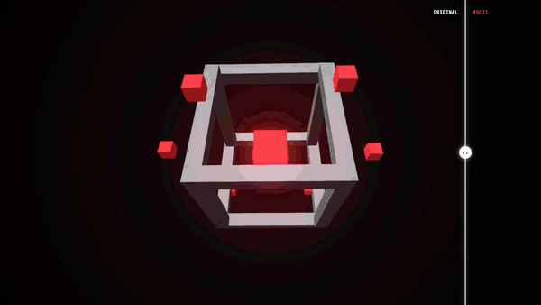
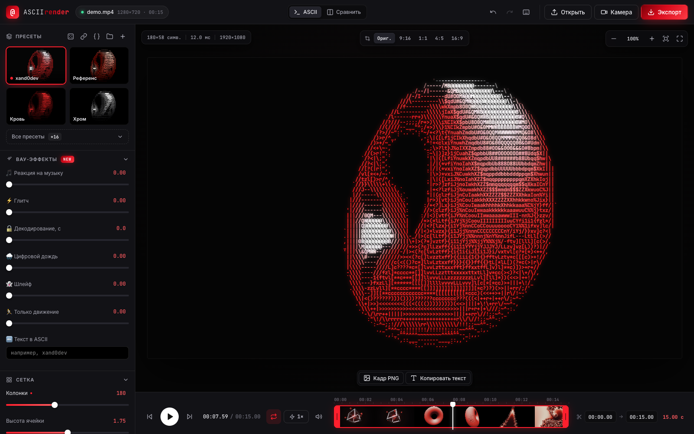
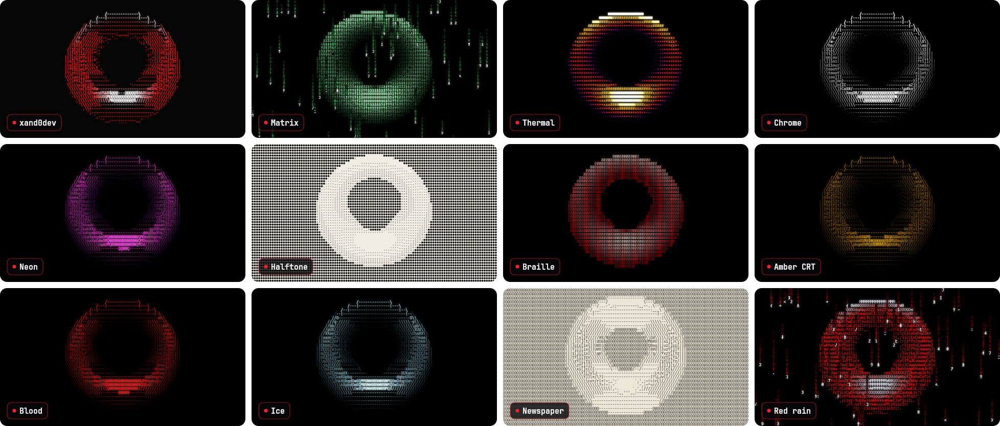
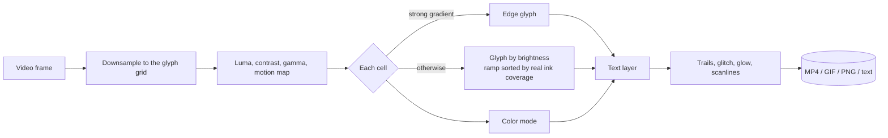

<div align="center">


# ASCII Render

**Turn any video into living ASCII art.**

A browser editor *and* an AI tool (MCP): colored glyphs, edge detection, glow, glitch, digital rain,<br />
beat-synced styles — exported to MP4, GIF, PNG or plain text. Everything runs on your machine.

[](https://github.com/xand0dev/ascii-render/actions/workflows/ci.yml)
[](LICENSE)


[**Live demo**](https://xand0dev.github.io/ascii-render/?demo) · [Quick start](#-quick-start) · [Use it from AI](#-use-it-from-ai-mcp) · [Presets](#-presets) · [How it works](#-how-it-works)



<sub>Every frame above is generated by ASCII Render itself from procedural scenes (<code>npm run assets</code>). <a href="docs/assets/demo.mp4">Watch the HD MP4</a>.</sub>

</div>

---

## ✨ Features

|   |   |
|---|---|
| 🎨 **Looks** | 20 presets · 9 glyph sets + your own · 6 monospace fonts · 5 color modes (original, mono, duotone, *accent* — keep one hue, grey out the rest — and thermal) · edges as `/ \ \| -` · glow · scanlines |
| ⚡ **Effects** | bass-reactive pulse · RGB-split glitch · "decode" intro · digital rain · motion trails · motion-only mode · your text drawn out of its own letters |
| 🎬 **Editing** | filmstrip timeline with trim handles · 1–15× speed · reframe to 9:16 / 1:1 / 4:5 / 16:9 · before/after wipe · A → B keyframes · switch presets on every beat |
| 📤 **Export** | MP4 (H.264 + AAC, up to 4K, GPU-encoded via WebCodecs) · GIF · PNG frame · frame as plain text |
| 🤖 **AI tool** | MCP server: Claude (or any MCP client) previews frames, *looks at them*, tweaks the style and renders the video for you |
| 🔒 **Private** | no backend, no uploads — the browser or your own Node process does all the work |

## 🖥 The editor



- **Drop a video** (or hit *Демо*) and tweak with live preview — ~10–20 ms per 1080p frame.
- **Zoom down to single glyphs**, pan around, compare with the original using the wipe.
- **Presets with live thumbnails** of your own footage, randomizer, undo/redo, save your own.
- **Share a style as a link** or a `.json` file; open `?demo` links to try it instantly.
- **Camera mode** with recording, keyboard shortcuts for everything (press <kbd>?</kbd>).

> The editor UI is in Russian for now — English UI is the first item on the [roadmap](#-roadmap).

## 🚀 Quick start

```bash
git clone https://github.com/xand0dev/ascii-render.git
cd ascii-render
npm install
npm run dev
```

Open <http://localhost:5173> and drop a video. MP4 export needs a Chromium browser (Chrome, Edge, Arc) for WebCodecs; GIF export works everywhere.

## 🤖 Use it from AI (MCP)

[MCP](https://modelcontextprotocol.io) is the standard way for AI assistants to use local tools. ASCII Render ships an MCP server built on the **same renderer** as the editor, so a style made in the browser looks identical when Claude renders it.

```text
You:     Make an ASCII version of ~/Desktop/clip.mp4 in the xand0dev style, 9:16, 4× faster
Claude:  ▸ video_info  ▸ preview_frame (looks at the result)  ▸ render_video
         Done: ~/Desktop/clip_ascii.mp4 — 1080×1920, 30 fps, 7.4 s, 18.2 MB
```

**Setup** — needs Node 20+ and ffmpeg (`brew install ffmpeg`):

```bash
npm install
npm run build:mcp
```

<details>
<summary><b>Claude Code</b></summary>

This repo includes [`.mcp.json`](.mcp.json), so running `claude` inside the folder offers to enable `ascii-render`. To have it everywhere:

```bash
claude mcp add ascii-render --scope user -- node /absolute/path/to/ascii-render/mcp/dist/server.mjs
```
</details>

<details>
<summary><b>Claude Desktop</b></summary>

Settings → Developer → Edit Config, then add:

```json
{
  "mcpServers": {
    "ascii-render": {
      "command": "/opt/homebrew/bin/node",
      "args": ["/absolute/path/to/ascii-render/mcp/dist/server.mjs"]
    }
  }
}
```

Restart Claude Desktop. Desktop apps start servers with a minimal `PATH`, so use the absolute path to `node`; if ffmpeg isn't found, add `"env": { "FFMPEG_PATH": "/opt/homebrew/bin/ffmpeg", "FFPROBE_PATH": "/opt/homebrew/bin/ffprobe" }`.
</details>

<details>
<summary><b>Cursor, Windsurf and other clients</b></summary>

Any MCP client that supports stdio servers works — point it at `node /absolute/path/to/ascii-render/mcp/dist/server.mjs`.
</details>

| Tool | What it does |
|---|---|
| `video_info` | resolution, duration, fps, audio |
| `list_styles` | every preset and every style parameter, documented for the model |
| `preview_frame` | renders one frame and returns the **image**, so the model can judge and iterate |
| `frame_to_text` | a frame as plain ASCII text — for READMEs, chats, terminals |
| `render_video` | MP4 with audio or GIF · trim · 1–15× speed · reframe · before/after · beat-synced presets · A → B transition |
| `editor_link` | a link that opens the web editor with the style applied |

Try the server without an AI client — it calls every tool like a real client would:

```bash
npm run mcp:test -- ~/Desktop/clip.mp4 /tmp
```

Extra fonts for the Node renderer (IBM Plex Mono, VT323…) go into `mcp/fonts/*.ttf`.

## 🎨 Presets



Tweak anything, then press **+** to save it as your own preset, **🔗** to copy a share link, or **{ }** to export it as `.json`. Presets can also be cycled on every beat of the music or blended from **A** to **B** across the clip.

## ⌨️ Shortcuts

| Key | Action | Key | Action |
|---|---|---|---|
| <kbd>Space</kbd> | play / pause | <kbd>C</kbd> | before/after wipe |
| <kbd>←</kbd> <kbd>→</kbd> | step a frame (<kbd>⇧</kbd> = 1 s) | <kbd>A</kbd> | cycle frame format |
| <kbd>I</kbd> <kbd>O</kbd> | set trim in / out | <kbd>[</kbd> <kbd>]</kbd> | slower / faster |
| <kbd>R</kbd> | random style | <kbd>T</kbd> | copy frame as text |
| <kbd>E</kbd> | export | <kbd>F</kbd> | fullscreen |
| <kbd>⌘Z</kbd> / <kbd>⇧⌘Z</kbd> | undo / redo | <kbd>+</kbd> <kbd>−</kbd> <kbd>0</kbd> | zoom / fit |

## 🧠 How it works



- Glyph ramps are **sorted by measuring each glyph's real pixel coverage** in the chosen font, so density maps to brightness correctly for any font or custom set.
- Time-based effects use a **deterministic hash**, so the preview and the export render the exact same glitch and rain.
- Audio is analysed once (low-pass → RMS → normalised envelope); beats are onsets in that envelope.
- One renderer, two runtimes: **Canvas 2D + WebCodecs** in the browser, **Skia ([@napi-rs/canvas](https://github.com/Brooooooklyn/canvas)) + ffmpeg** in the MCP server.

```text
src/
  ascii.ts      the renderer (shared by browser and Node)
  looks.ts      beat switching, A → B blending, reframing
  audio.ts      bass envelope and beat detection
  export.ts     WebCodecs MP4 + GIF export
  main.ts, ui/  the editor
mcp/            MCP server: tools, ffmpeg pipeline, Node canvas platform
scripts/        procedural scenes + generator for every image and video in this README
```

## 🛠 Scripts

| Command | |
|---|---|
| `npm run dev` | editor with hot reload |
| `npm run build` | type-check and build the editor into `dist/` |
| `npm run build:mcp` | bundle the MCP server into `mcp/dist/server.mjs` |
| `npm run mcp:test -- <video> [outDir]` | smoke-test every MCP tool |
| `npm run assets` | regenerate logo, demo reel, preset gallery, social preview and the in-app demo clip |

## 🗺 Roadmap

- [ ] English UI (i18n)
- [ ] WebGL renderer for real-time 4K preview
- [ ] Transparent-background export (WebM with alpha)
- [ ] Batch processing of a folder
- [ ] Publish the MCP server to npm (`npx ascii-render-mcp`)

Ideas and bug reports are welcome in [issues](https://github.com/xand0dev/ascii-render/issues).

## 🤝 Contributing

PRs are welcome — see [CONTRIBUTING.md](CONTRIBUTING.md). The short version: `npm install`, `npm run dev`, keep `npm run build` and `npx tsc -p mcp/tsconfig.json` green.

## 📄 License

[MIT](LICENSE) © Oleksandr Riasnyi

<sub>Inspired by Andy Sloane's <a href="https://www.a1k0n.net/2011/07/20/donut-math.html">donut.c</a> and Paul Bourke's character ramp.</sub>
